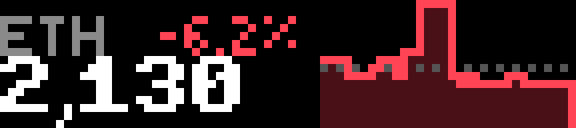
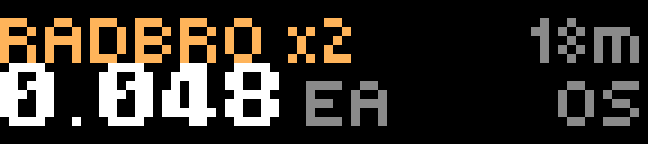
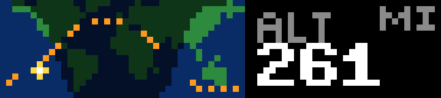
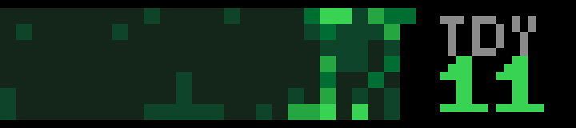

# BUSY Bar apps

JavaScript apps for the [BUSY Bar](https://busy.bar), each one a separate project built from the BUSY JS app template. The bar's front screen is 72×16 RGB pixels. Apps run on the device in its JerryScript runtime and draw through the bar's local HTTP API.

| App | | What it shows |
| --- | --- | --- |
| [Crypto](ticker/) |  | Coinbase prices with a sparkline, for a list of coins and four timeframes |
| [Remilia](remi/) |  | Live on-chain sales of Milady, Remilio, Radbro, SchizoPosters and YAYO |
| [Sky](sky/) |  | Weather now and for 7 days, each with a 24-hour chart |
| [ISS](orbit/) |  | Where the space station is, on a world map with its next orbit |
| [Luna](luna/) |  | Moon phase, next full and new moon, sunrise and sunset, all computed on the bar |
| [Commits](commits/) |  | A GitHub contribution graph with today, week, streak and year |

None of them need an API key, and Luna needs no network at all once it knows where you are.

## Building and installing

Every app builds the same way. The template's toolchain needs **Node 24**; Node 26 breaks the build.

```sh
cd sky
npm install
npm run build                                  # dist/app.itstylerirl.sky.tgz
npm run app:install -- --addr 10.0.4.20        # 10.0.4.20 is the bar over USB
npm run app:run -- --addr 10.0.4.20
```

Over Wi-Fi, pass the bar's network address instead, plus `--password <password>` if the API is password protected. `npm run typecheck` type-checks an app. Each app's `AGENTS.md` has the template's rules for the runtime: lifecycle, timers, and keeping requests cheap.

Each app's settings are declared in `src/appmeta/settings.json`; the defaults apply until you change them.

## Layout

```
busy-apps/
├── <app>/
│   ├── src/main.ts            entry point
│   ├── src/appmeta/           manifest.json, settings.json
│   ├── shared/bar.ts          raw-fetch client for the bar's HTTP API
│   └── README.md
├── tools/snap.py              captures the screen to a PNG
└── docs/                      screenshots
```

## Firmware notes

These apps were written against firmware 1.3.1 (HTTP API 27.14.0). A few things the template does not tell you:

- **busy-lib's client does not work on the device.** Its `BusyBar` client needs `AbortSignal` and `URLSearchParams`, which the runtime lacks, so each app talks to the API with plain `fetch` through `shared/bar.ts`.
- **Draw at priority 60.** A launched app's draws at the template's priority 50 are refused with a 409.
- **Timer ids start at 0.** `if (timer) clearInterval(timer)` skips the first timer, and a timer that is never cleared keeps the app alive after Back. Compare against `undefined`.
- **An element id cannot change type.** Sending a `text` element under an id that was an `xpmbitmap` fails with a 400, so placeholder frames reuse the same types.
- **Fonts:** `tiny` has no `°`; `small`, `bold`, `large` and `extra_large` do. `small` is about 5px per character, and `bold` about 7px per digit and 8px tall.
- **`xpmbitmap` elements** take XPM2 text. That is how the icons, charts and maps here are drawn, generated in code on the device.
- **Text can sit at y = −1.** `small` text anchored `top_left` at y 0 starts a row or two down, so it can touch a `bold` value below it; y −1 leaves a gap.
- **Wi-Fi can drop DNS** for minutes at a time. Any lookup an app needs once, such as the location, has to retry, not just the regular polls.
- **Simulated keys** (`POST /api/input`) drive the bar's menus but do not reach a running JS app.

## Screenshots

`tools/snap.py` saves the front screen as an upscaled PNG. `GET /api/screen` returns the frame buffer as base64 **BGR**, which the script swaps to RGB.

```sh
python tools/snap.py screen.png [host]
```
