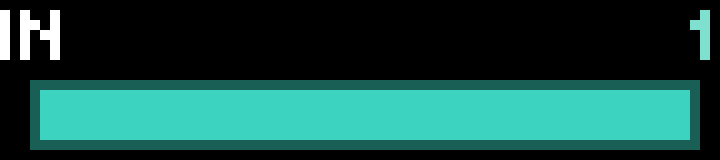

# Breathe

Guided breathing. A soft teal bar swells and brightens as you breathe in, holds, and shrinks as you breathe out. The step (`IN`, `HOLD`, `OUT`) and its seconds count down above it.

| Pattern | |
| --- | --- |
| Box 4-4-4-4 | In 4, hold 4, out 4, hold 4 |
| Relax 4-7-8 | In 4, hold 7, out 8 |
| Coherent 5.5 | In 5.5, out 5.5 (about 5.5 breaths a minute) |

The bar eases in and out at the ends of each breath. Its size is worked out from the clock, so a slow frame never throws the rhythm off. The session ends at the end of a whole breath once the chosen length is up, with a chime and the number of breaths.

## Controls

| Input | Action |
| --- | --- |
| Wheel | Pattern (while stopped; remembered) |
| OK / Start | Start; pause / resume; again |
| Back | Quit |

## Settings

| Setting | Default |
| --- | --- |
| Session length | 3 minutes (1–20) |
| Chime at the end | on |

## Behavior

It draws about four frames a second while a session runs, and nothing while stopped or paused.

## Build

See the [top-level README](../README.md#building-and-installing). App id `app.itstylerirl.breathe`.
