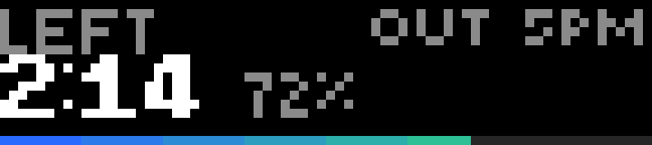

# Clock Out

How long until the workday ends.

| When | Screen |
| --- | --- |
| Before work | `STARTS IN` and a blue countdown to the start time |
| During work | `LEFT`, the countdown, the share of the day done, and a progress bar along the bottom fading from blue to green |
| Last 15 minutes | The countdown and bar turn gold |
| Quitting time | `GO HOME` in green, with a chime and a green LED flash (once a day) |
| A day off | `DAY OFF` · `ENJOY` |

The top right shows the end time (or the start time before work). It runs offline: the bar's clock gives the time and its time zone setting the local offset, checked hourly so daylight saving time is picked up. It redraws once a minute, on the minute.

## Controls

| Input | Action |
| --- | --- |
| Start | 12 ⇄ 24-hour (remembered) |
| Back | Quit |

## Settings

| Setting | Default |
| --- | --- |
| Workday starts / ends | `09:00` / `17:00` (24-hour `HH:MM`) |
| Monday – Sunday | Monday to Friday on |
| Clock | 12-hour |
| Chime at quitting time | on (it only plays within 5 minutes of the end time, so opening the app later in the evening is quiet) |

## Build

See the [top-level README](../README.md#building-and-installing). App id `app.itstylerirl.clockout`.
