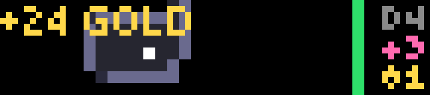

# Delve

A turn-based dungeon crawler. Ten levels down, a dragon guards the Crown. Take it and you win; die on the way and the run is over.

Nothing moves until you do, so the bar's slow drawing never matters: one frame per turn, and none while you think.

## Playing

| Input | Action |
| --- | --- |
| Wheel | Step left / right |
| OK | Step up |
| Start | Step down |
| Hold OK | Drink a potion |
| Hold Start | Rest a turn |
| Back | Quit; the run is saved and resumes next time |

Walk into a monster to fight it, onto an item to pick it up, and onto the gold stairs to go deeper.

## The screen

- **The map:** 2-pixel tiles, scrolled to keep you in view. You see 5 tiles in any clear direction. Walls and floor you've seen stay on the map, dimmed.
- **You** are the white tile. **Monsters** are solid tiles in their color. **Items** are a diagonal pair of pixels: pink potions, yellow gold, light-blue swords, gray armor, and the Crown in gold.
- **Right edge:** your health bar, filling from the bottom and going from green to yellow to red. Beside it are the depth (`D4`), your potions (`+3`) and your gold.
- **Messages** (`HIT ORC 5`, `+24 GOLD`, `LEVEL 3!`) appear at whichever edge is further from you. The LED flashes red when you're hit, blue on the stairs and gold on a level-up.

## The dungeon

Every level is generated: up to nine rooms joined by corridors on a 48×24 map.

| Depth | Monsters |
| --- | --- |
| 1–2 | Rats, bats (which flutter erratically), goblins |
| 3–6 | Goblins, orcs, skeletons |
| 7–9 | Skeletons, trolls |
| 10 | Trolls, and the dragon on the Crown |

Monsters that see you keep chasing you. Experience from kills levels you up: more health, a harder hit, and some healing. Swords add attack, armor reduces every hit, and potions heal more the higher your level. You also heal one point every eight turns. Your deepest dive is kept on the title screen.

## Tested

The rules (`src/game.ts`) have no device code, so they were tested in Node by a bot playing 300 seeded games, 2,744 generated levels in all. Every level's stairs or Crown could be reached, and nobody ever stood in a wall or on another monster. Saving and loading round-tripped exactly. The bot won half its games, and most of its deaths came on depth 7 or deeper. On the bar a turn takes about 150 ms to work out and draw, and a saved run is about 2.6 KB.

## Settings

| Setting | Default |
| --- | --- |
| Sounds | on: pickups, the stairs, level-ups, and the end |

## Build

See the [top-level README](../README.md#building-and-installing). App id `app.itstylerirl.delve`.
