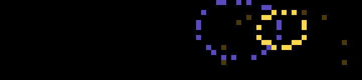

# Fireworks

A fireworks show. Rockets climb from the bottom with a flickering trail and burst into one of three shells:

- **Peony:** a full sphere of sparks at mixed speeds.
- **Ring:** sparks all at one speed, a clean circle.
- **Willow:** slow gold sparks that hang and droop.

Sparks fall under gravity, slow with air drag, and fade from bright to dim in six colors.

## Controls

| Input | Action |
| --- | --- |
| Wheel | How busy the sky is, 1–5 (remembered) |
| OK | Finale: four rockets at once, a pop and a gold LED flash |
| Start | Pause / resume |
| Back | Quit |

## Behavior

Motion follows the clock, so the show runs at the same pace however fast frames are drawn. As in [Life](../life/), the next frame is worked out while the bar is still drawing the current one, about 4–5 frames a second. Sparks are capped at 160.

## Settings

| Setting | Default |
| --- | --- |
| Pop on the finale | on |

## Build

See the [top-level README](../README.md#building-and-installing). App id `app.itstylerirl.fireworks`.
