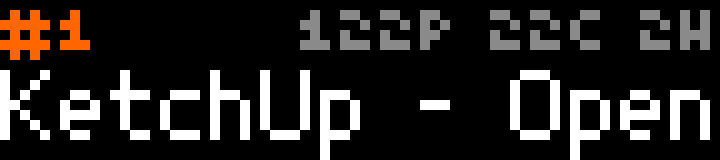

# Headlines

A Hacker News ticker, from the [official HN API](https://github.com/HackerNews/API) (free, no key).

- **Top row:** the story's rank in HN orange, then points, comments and age (`122P 22C 2H`).
- **Bottom row:** the title, scrolling with the bar's own text scrolling, so the app sends nothing while it moves.

Each story stays up until its title has scrolled past once, at least 7 seconds, then the next one comes up. Titles are converted to the plain ASCII the bar's fonts can draw: curly quotes, dashes and accented letters become their plain versions, and emoji are dropped.

## Controls

| Input | Action |
| --- | --- |
| Wheel | Previous / next story |
| OK | Pause / resume (the rank turns white while paused) |
| Start | Back to #1, refreshing the list if it is more than a minute old |
| Back | Quit |

## Settings

| Setting | Default | |
| --- | --- | --- |
| Feed | Top | Top, Best, New, Ask HN or Show HN |
| Stories in the rotation | 30 | 5–50 |

## Behavior

The story list refreshes every 10 minutes. Stories are fetched one at a time as they come up, with the next one fetched ahead, and a story older than 5 minutes is refreshed when it comes around again. Only the stories in the current list are kept in memory. A failed list fetch shows `OFFLINE` and retries after 30 seconds, doubling up to 10 minutes.

## Build

See the [top-level README](../README.md#building-and-installing). App id `app.itstylerirl.headlines`.
