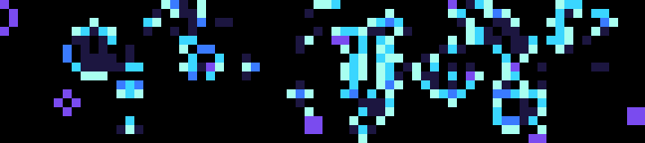

# Life

Conway's Game of Life on the 72×16 screen, as a screensaver. Cells are colored by age: bright cyan when newborn, through blue, to purple once they have lived seven generations. A cell that just died leaves a faint trace.

| Pattern | |
| --- | --- |
| Soup | A random third of the screen, reseeded when it settles or after 900 generations |
| Glider gun | Bill Gosper's gun, firing a glider every 30 generations |
| Acorn | Seven cells that grow for thousands of generations |
| R-pentomino | Five cells, the classic long-lived chaos |
| Pulsar | A period-3 oscillator |

The world is a little larger than the screen, and its outer edge is cleared every generation, so gliders fly off and disappear instead of piling up as debris. A world that dies out or settles into still lifes and blinkers starts again after a moment.

## Controls

| Input | Action |
| --- | --- |
| Wheel | Pick a pattern (its name shows for a moment; remembered) |
| OK | Restart the pattern |
| Start | Pause / resume |
| Back | Quit |

## Settings

| Setting | Default |
| --- | --- |
| Generations per second | 3 (1–4) |

## Making it fast enough

The bar's JavaScript engine is slow per operation: a loop iteration costs about 7 µs, and a straightforward cell-by-cell generation took **2.2 s**. Three changes bring it to 3 generations a second:

- **Bit-sliced rules.** Each row is held as 24-bit words, and the eight neighbour counts for a whole word are summed at once with a 3-bit ripple counter of bitwise operations. Areas with nothing alive nearby are skipped. Cell ages are kept the same way, as three bit planes.
- **A two-pixel lookup table** turns the bit planes into the XPM image without visiting each pixel separately.
- **Computing during the draw.** The next generation is worked out while the bar is still drawing the current one, so the rate is set by the slower of the two (each takes roughly 250–300 ms), not by their sum.

Every drawn frame was checked against a plain reference implementation for the glider gun, acorn and R-pentomino at generations 1, 60 and 150.

## Build

See the [top-level README](../README.md#building-and-installing). App id `app.itstylerirl.life`.
