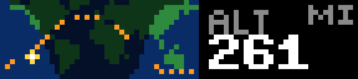

# ISS

Where the International Space Station is right now, from [wheretheiss.at](https://wheretheiss.at) (free, no key).

- **Map** (left, 40×16): land and ocean, with the night side shaded from where the sun is overhead. The station is a white dot whose glow is yellow when it is in sunlight (the times it can be seen from the ground at dusk or dawn) and gray in Earth's shadow. A dotted orange line shows its path over the next orbit, about 90 minutes, and a red dot marks home.
- **Readout** (right): position, altitude, speed, and distance from home. It switches every 5 seconds. The distance turns yellow under 2,000 km, when the station can be above your horizon.

The map covers latitudes 76°N to 59°S, which is everything the ISS flies over. The land mask in `src/land.ts` is rasterized from [Natural Earth](https://www.naturalearthdata.com) 1:110m land, which is public domain.

## Controls

| Input | Action |
| --- | --- |
| Wheel | Pick a readout (stops the rotation) |
| OK | Resume the rotation |
| Start | Miles ⇄ km (remembered) |
| Back | Quit |

## Settings

| Setting | Default | |
| --- | --- | --- |
| Home | blank | `lat,lon`. Blank looks up an approximate location from your IP address with [ip-api.com](https://ip-api.com) once and remembers it on the bar. |
| Units | Miles | |

## Behavior

It checks the position every 10 seconds and fetches the next orbit every 10 minutes (10 timestamps 9 minutes apart, the API's limit per request). A failed fetch doubles the wait, up to 5 minutes. The map moves about a pixel every couple of minutes, and only changed elements are sent.

## Build

See the [top-level README](../README.md#building-and-installing). App id `app.itstylerirl.orbit`.
