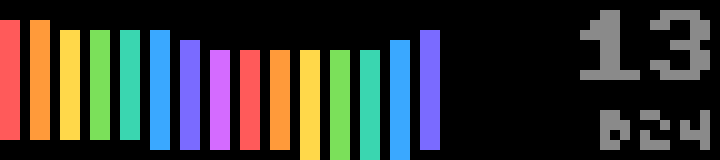

# Pillar

A one-button timing game. The tower grows sideways across the screen, one column per layer, each in the next color around the wheel.

- A block slides up and down beside the tower. Press **OK** to drop it.
- Whatever overhangs the layer below is cut off, so the block shrinks as you go.
- A **perfect** drop keeps the full block and flashes the LED gold. Three perfect drops in a row win back a pixel.
- Each layer is a little faster. Miss the layer below entirely and the game is over.

Your score is the number of layers; the best is kept on the bar. Once the tower fills the screen, the view scrolls along with it.

## Controls

| Input | Action |
| --- | --- |
| OK | Start; drop the block (on the press, not the release); play again |
| Start | Start / play again |
| Back | Quit |

## Timing and frame rate

The block's position is worked out from the clock, not counted in frames, so a drop lands exactly where the block was when you pressed, even if the screen was a frame behind.

The bar manages about 5 frames a second (each draw is an HTTP request to its own web server, about 200 ms), so the speed is capped at 20 px/s to keep the block within a few pixels of where you last saw it. Frames run only while a block is moving. Each one sends just the block's position; the tower is redrawn only when a layer lands.

## Settings

| Setting | Default |
| --- | --- |
| Sounds | on: a click for a perfect drop, a tone when the game ends |

## Build

See the [top-level README](../README.md#building-and-installing). App id `app.itstylerirl.pillar`.
