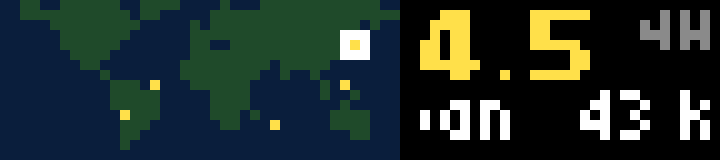

# Quakes

Recent earthquakes from the [USGS live feeds](https://earthquake.usgs.gov/earthquakes/feed/v1.0/geojson.php) (free, no key), on the same 40×16 world map as [ISS](../orbit/).

- **Map:** each quake is a dot colored by magnitude: yellow under 5, orange 5–6, red 6–7, magenta 7 and up. Quakes of 6 or more are drawn as a cross. The one being shown is ringed in white.
- **Right:** the magnitude in bold, in the same color, with its age (`4H`). Below it the place (`43 km E of Onagawa Cho, Japan`) scrolls with the bar's native text scrolling.

The quakes step through every 8 seconds, newest first. A new quake at or above the alert magnitude flashes the LED red and jumps to the front.

## Controls

| Input | Action |
| --- | --- |
| Wheel | Pick a quake (stops the stepping) |
| OK | Resume stepping |
| Start | Refresh now |
| Back | Quit |

## Settings

| Setting | Default | |
| --- | --- | --- |
| Earthquakes | M4.5+, past day | Also M2.5+ past day (about 30 KB, mostly the US; fits the default 128 KB heap) or significant quakes in the past month |
| Alert at | M6 | The LED flash for a new quake |

## Behavior

The feed refreshes every 5 minutes, and only the newest 40 quakes are kept, with just the fields the screen uses. A failed fetch shows `OFFLN` and retries after 1 minute, doubling up to 5. The map covers latitudes 76°N to 59°S; quakes beyond that are drawn on the top or bottom row.

## Build

See the [top-level README](../README.md#building-and-installing). App id `app.itstylerirl.quakes`.
