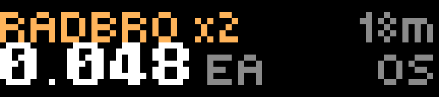

# Remilia

Live on-chain sales of the Remilia collections: Milady, Remilio, Radbro, SchizoPosters and YAYO. It reads Ethereum directly through the public [MEV Blocker](https://mevblocker.io) RPC, with no indexer and no key.

- **Top:** the collection, in its own color, with the token number, or `x N` for a sweep. The top right shows how long ago it sold, or `NEW`.
- **Bottom:** the price in ETH (each, for a sweep), then the USD value at Coinbase's ETH price. With USD turned off, or before the price loads, it shows the venue instead: `OS`, `OS offer` or `Blur`. An accepted offer prints in a paler white than a bought listing.

A new sale chimes and flashes the LED.

## How it finds sales

It polls `eth_getLogs` for `Transfer` events of the watched collections, 1,000 blocks per request. For each transaction it reads the receipt and keeps only the transfers a marketplace event prices: Seaport (OpenSea, including accepted offers) and Blur. A sweep of several tokens collapses into one entry priced per token. The decoder is in `src/decode.ts`.

On a cold start it looks back up to 10,000 blocks (about a day and a half) until it has a handful of sales. After that it resumes from the last block it saw, if that block is recent enough.

## Controls

| Input | Action |
| --- | --- |
| Wheel | Browse the last 12 sales |
| OK | Jump to the newest |
| Back | Quit |

The view goes back to the newest sale after 45 seconds untouched.

## Settings

| Setting | Default |
| --- | --- |
| Milady / Remilio / Radbro / SchizoPosters / YAYO | all on |
| Chime on new sale | on |
| Show USD value | on |

## Behavior

It polls every 30 seconds. A failure doubles the wait, up to 5 minutes. The ETH/USD price refreshes every 5 minutes.

## Build

See the [top-level README](../README.md#building-and-installing). App id `app.itstylerirl.remi`.
