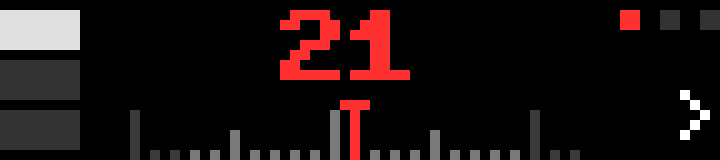

# Safecracker

A game for the wheel: find the three-number combination on a 0–39 dial before the alarm goes off. It runs entirely offline.

- **Middle:** the dial number over a strip of tick marks. Their color tells you how close you are to the current tumbler's number:

  | Color | Distance |
  | --- | --- |
  | Blue | 10 or more |
  | Gray | 5 to 9 |
  | Orange | 2 to 4 |
  | Red | 0 or 1 |

- **Left:** the three tumblers: green once open, white for the one you are working on.
- **Top right:** three lights. A wrong try uses one up, and the bottom-right corner shows `<` or `>` for the shorter way to the number. A wrong try with no lights left sets off the alarm.

Red only narrows a tumbler down to three numbers, so each one is a small gamble. Crack all three to open the safe; your time is shown, and the best one is kept on the bar.

## Controls

| Input | Action |
| --- | --- |
| Wheel | Turn the dial (the clock starts on the first turn) |
| OK | Try the number; after OPEN or ALARM, the next safe |
| Start | New safe |
| Back | Quit |

## Sounds and light

A click for each tumbler, a chime and a green LED flash when the safe opens, and a tone with a red flash for the alarm. They use the bar's stock sounds and can be turned off in the settings.

## Behavior

There are no timers or polling: the app draws only when you turn or press something, and sends only the elements that changed.

## Build

See the [top-level README](../README.md#building-and-installing). App id `app.itstylerirl.safe`.
