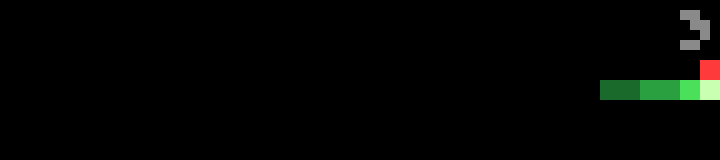

# Serpent

Snake, steered with the wheel, on a 36×8 board of 2-pixel cells.

- **Clockwise turns right, counterclockwise turns left.** Turns queue up, two at most, so a quick double click makes a U-turn.
- Each red apple grows the snake by one and speeds it up a little, from 3 moves a second to a cap of 4.
- The snake fades from a bright head to a dark tail. Walls and your own body end the game.

The score is in the top-right corner while you play; the best is kept on the bar.

## Controls

| Input | Action |
| --- | --- |
| Wheel | Turn right / left |
| OK / Start | Start; pause / resume; play again |
| Back | Quit |

## Frame rate

The bar takes about 250 ms to draw a full 72×16 frame, so the next move is computed while the current frame is still being drawn (the same trick as [Life](../life/)), and the speed is capped at 4 moves a second. A test run made 40 moves in 12.5 seconds at the starting speed.

## Settings

| Setting | Default |
| --- | --- |
| Sounds | on: a click for each apple, a tone when the game ends |

## Build

See the [top-level README](../README.md#building-and-installing). App id `app.itstylerirl.serpent`.
