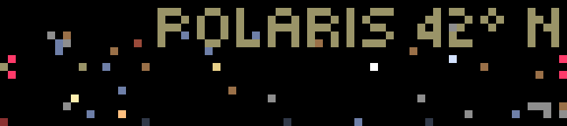

# Stars

A live planetarium: the whole sky around you, unrolled onto the 72×16 screen.

- **Across:** compass bearing at 5° a pixel: north at the left edge, then east, **south in the middle**, west, and back to north. Faint marks on the bottom row show the four points, with north in red.
- **Up:** height above the horizon, from the horizon on the bottom row to straight overhead at the top.
- **Stars:** about 70 of the brightest, including the Pleiades as one, tinted by their real color: blue-white Rigel and Vega, yellow Capella, orange Arcturus and Aldebaran, red Betelgeuse and Antares. Stars brighter than magnitude 1 are drawn brighter.
- **Moon, planets and sun:** the moon is a 2×2 block, brighter when it's more than 40% lit. Mercury, Venus, Mars, Jupiter and Saturn are drawn in their own colors, and the sun as a small cross.
- **The sky's color follows the sun:** blue by day, darkening through civil, nautical and astronomical twilight. Stars fade in as it gets dark, the brightest first.

## Controls

| Input | Action |
| --- | --- |
| Wheel | A cursor sweeps east to west across what is up, naming it: `JUPITER 42° SE`. It starts on the sun, the moon or a bright planet, and hides after 8 seconds. |
| OK | Hide the cursor |
| Start | **Time-lapse:** the sky turns ten minutes a frame, with the clock in the corner; press again to return to now |
| Back | Quit |

## Accuracy

Everything is computed on the bar, with no data service. `src/sky.ts` has the sun and moon from truncated series (Meeus), and the planets from JPL's approximate Keplerian elements, solving Kepler's equation for each planet and for Earth. Checked against [JPL Horizons](https://ssd.jpl.nasa.gov/horizons/) for the sun, moon and five planets from Chicago at three dates in 2025–2027, the worst error was **0.9°** (the moon; Horizons includes parallax). The planets were within 0.4°, which is the precession since 2000. A pixel is 5°.

## Settings

| Setting | Default | |
| --- | --- | --- |
| Location | blank | `lat,lon`. Blank looks up an approximate location from your IP address with [ip-api.com](https://ip-api.com) once and remembers it on the bar, retrying with a growing wait if the lookup fails. |

## Behavior

In real time the sky is recomputed once a minute (a star moves a pixel about every 20 minutes). The time-lapse draws as fast as the bar accepts frames, about 2 a second. The local time zone, for the time-lapse clock, comes from `GET /api/time`.

## Build

See the [top-level README](../README.md#building-and-installing). App id `app.itstylerirl.stars`.
