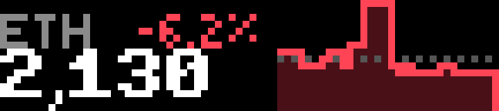

# Crypto

Crypto prices with charts, from the public [Coinbase Exchange](https://docs.cdp.coinbase.com/exchange/) candles API (free, no key).

- **Top left:** the coin. A trailing dot means auto-rotate is paused.
- **Top right:** the change over the chosen timeframe, in green or red.
- **Bottom left:** the price, in the widest font that fits.
- **Right:** a 32px sparkline with a dim fill under the line and a dotted baseline at the opening price.

## Controls

| Input | Action |
| --- | --- |
| Wheel | Previous / next coin (pauses auto-rotate) |
| OK | Next timeframe: 1H → 24H → 7D → 30D (remembered) |
| Start | Pause / resume auto-rotate |
| Back | Quit |

## Settings

| Setting | Default | |
| --- | --- | --- |
| Coins | `BTC,ETH,LINK` | Coinbase symbols, priced in USD, up to 12 |
| Default chart | 24 hours | |
| Auto-rotate | 10 s | 0 turns it off |

## Behavior

A chart is cached for a minute. The visible one refreshes on that schedule, and a coin the wheel spins past is not fetched until the wheel stops. A failed fetch shows `offline` (or `n/a` for an unknown symbol) and waits 15 seconds before trying that chart again.

## Build

See the [top-level README](../README.md#building-and-installing). App id `app.itstylerirl.ticker`.
